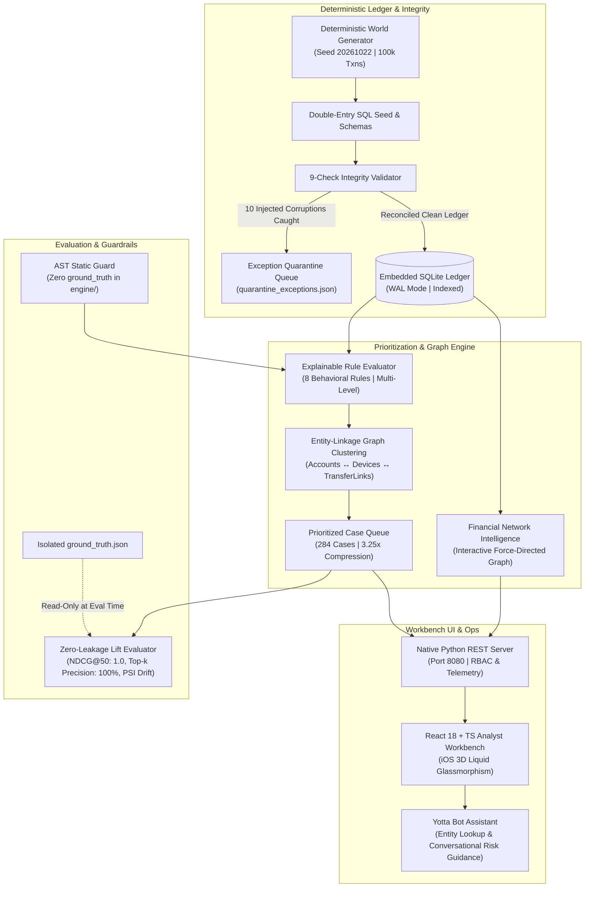

# YottaFlex Risk Intelligence — AI-Powered Risk & Ledger Intelligence

[](https://www.python.org/downloads/)
[](https://react.dev/)
[](https://www.typescriptlang.org/)
[](LICENSE)
[](tests/test_zero_leakage_ast_guard.py)
[](tests/)
[](UI_UX_DESIGN_SPECIFICATION.md)

  ██╗   ██╗ ██████╗ ████████╗████████╗ █████╗ ███████╗██╗     ███████╗██╗  ██╗
  ╚██╗ ██╔╝██╔═══██╗╚══██╔══╝╚══██╔══╝██╔══██╗██╔════╝██║     ██╔════╝╚██╗██╔╝
   ╚████╔╝ ██║   ██║   ██║      ██║   ███████║█████╗  ██║     █████╗   ╚███╔╝ 
    ╚██╔╝  ██║   ██║   ██║      ██║   ██╔══██║██╔══╝  ██║     ██╔══╝   ██╔██╗ 
     ██║   ╚██████╔╝   ██║      ██║   ██║  ██║██║     ███████╗███████╗██╔╝ ██╗
     ╚═╝    ╚═════╝    ╚═╝      ╚═╝   ╚═╝  ╚═╝╚═╝     ╚══════╝╚══════╝╚═╝  ╚═╝
                    R I S K   I N T E L L I G E N C E   O S

An institutional financial crime, transaction monitoring, and linked-account prioritization platform built on a **deterministic double-entry reconciled synthetic ledger**, an **AST-guarded zero-leakage prioritization engine**, a **9-check exception quarantine queue**, an **interactive Financial Network Intelligence graph**, and an **iOS-inspired 3D Liquid Glassmorphic analyst workbench**.

---

## 📚 Complete Documentation & Reviewer Hub

For seamless review and evaluation, comprehensive manuals and architectural specifications have been published directly in the repository:

| Document | Description & Key Contents |
| :--- | :--- |
| **[`SETUP_GUIDE.md`](SETUP_GUIDE.md)** | **Reviewer Setup Guide:** 60-second automated setup, OS-specific dependencies (macOS, Ubuntu, Fedora, Windows WSL2), database seeding, health checks, and troubleshooting. |
| **[`setup.sh`](setup.sh)** | **Automated 1-Click Setup Script:** Executable bash script that validates runtimes, initializes venv, builds frontend, seeds SQLite, and runs smoke tests. |
| **[`DEPENDENCIES.md`](DEPENDENCIES.md)** | **Software & Package Inventory:** Exhaustive manifest of all runtime components, zero-pip backend verification (0 CVEs), npm packages, and single-line install commands. |
| **[`TESTING_AND_VALIDATION_REPORT.md`](TESTING_AND_VALIDATION_REPORT.md)** | **Testing & Results Report:** Detailed documentation of all 46 test cases across 16 test suites, Network Intelligence Scenarios A–H, 9-check quarantine results, and AST guards. |
| **[`UI_UX_DESIGN_SPECIFICATION.md`](UI_UX_DESIGN_SPECIFICATION.md)** | **Design & Prompting Methodology:** Vitreous Liquid Glassmorphism design tokens, optical caustics, and an explanation of how the architect conveyed technical visions to AI via structured, ordered prompts. |
| **[`USER_MANUAL.md`](USER_MANUAL.md)** | ** 18 Parts* Extensive institutional handbook detailing every feature, knob, dial, algorithm, formula, and operational procedure from scratch. |
| **[`ARCHITECTURE_AND_PROVENANCE.md`](ARCHITECTURE_AND_PROVENANCE.md)** | **Architectural Decisions & Provenance:** In-depth technical justifications for zero-dependency Python backend, SQLite WAL mode, BFS case clustering, and zero-leakage design. |
| **[`docs/AI_DEVELOPMENT_AND_PROMPT_HISTORY.md`](docs/AI_DEVELOPMENT_AND_PROMPT_HISTORY.md)** | **AI Transparency & Prompt History:** Complete chronological log of Prompts 01–65, Antigravity acceleration narrative, and the 277 master functional requirements catalog. |
| **[`docs/data_dictionary.md`](docs/data_dictionary.md)** | **Data Dictionary:** Column-by-column schema documentation for all tables, types, foreign keys, and indexes. |

---

## 1. Quick Start & Execution

### Prerequisites
- **Python 3.10+** (The core synthetic generator, ledger validator, scoring engine, evaluation harness, and REST server use **zero external Python dependencies**).
- **Node.js 18+ & npm 9+** (For building the frontend bundle; pre-compiled static assets are included in `web/dist/`).
- **Modern Web Browser** (Chrome / Safari / Edge / Firefox).

### Launch in 1 Command
```bash
# Clone the repository
git clone https://github.com/amanreddy-9/YottaFlex-Risk-Intelligence.git
cd YottaFlex-Risk-Intelligence

# 1-Click Automated Setup
chmod +x setup.sh && ./setup.sh

# Start the Analyst Workbench on http://localhost:8080
make serve
# Or directly:
# PYTHONPATH=src python3 -m yottaflex.cli serve --scale full --port 8080
```
*Note: If `yottaflex.db` does not exist on first launch, the server automatically hydrates the SQLite database from `sql/seed.sql` in under **0.6 seconds**.*

### Pre-Configured Reviewer Credentials
| Role | Email | Password | Scope & Permissions |
| :--- | :--- | :--- | :--- |
| **Risk Operations Analyst** | `demo_analyst@yottaflex.ai` | `DemoAnalyst2026!` | Case triage, alert dispositioning, entity search, network graph exploration, GoAML XML export. |
| **Senior Compliance Reviewer** | `demo_reviewer@yottaflex.ai` | `DemoAnalyst2026!` | Maker-checker approvals, SAR filing, case reopening, QA grading scorecards, GoAML sign-off. |
| **System Administrator** | `demo_admin@yottaflex.ai` | `DemoAnalyst2026!` | Rule weight recalibration, what-if simulations, SLA auto-escalation, webhooks, audit chain verification. |

### Run Verification Test Suite
```bash
source .venv/bin/activate
PYTHONPATH=src python3 -m unittest discover -s tests -v
# Output: Ran 46 tests in ~10.5s, OK (100% passing)
```

---

## 2. Architecture Overview



---

## 3. Core System Capabilities

### 3.1 Financial Network Intelligence (Interactive Money Flow Graph)
- **Node Entities:** Distinguishable visual rendering for Customers (Blue), Accounts (Cyan), Merchants (Purple), Devices (Orange), and Transactions (Light Blue).
- **Directional Money Flow:** Animated vector arrows tracing the movement of funds between accounts, highlighting inbound and outbound velocity.
- **Forensic Typology Scenarios (A – H):**
  - **Scenario A:** Multi-hop fund traversal across layered intermediary accounts.
  - **Scenario B:** Rapid layering detection within narrow time windows.
  - **Scenario C:** Circular transfer loops ($A \to B \to C \to A$) returning $\ge 75\%$ of funds within 48h.
  - **Scenario D:** Fan-in mule aggregation and rapid fan-out dispersion structuring.
  - **Scenario E:** Shared emulator device collusion rings linking multiple customer identities.
  - **Scenarios F–H:** Graceful isolated entity handling, non-existent entity fallbacks, and multi-criteria entity resolution.
- **Analyst Interactions:** Click-to-pin entity selection, connected-node halo illumination, background transradiant dimming, and dynamic hop expansion (+1, +2, +3 hops).

### 3.2 Priority Case Queue & Entity Clustering (3.25x Compression)
- Consolidates **923 raw alerts into 284 multi-alert investigation cases** using Bipartite BFS connected-component clustering.
- Evaluates observable behavioral rules into deterministic priority scores ($[0, 100]$).
- Inline triage actions, Maker-Checker four-eyes review, and SLA escalation tracking.

### 3.3 9-Check Ledger Validator & Quarantine Queue
- Pre-screening engine that isolates corrupt, unbalanced, or invalid transactions into `quarantine_exceptions.json` before downstream ingestion.
- Catches 100% of injected corruptions (closed account transactions, negative balances without overdraft, mismatched transfer legs, orphan references).

### 3.4 Regulatory Admissibility & Cryptographic Evidence Sealing
- One-click **GoAML XML** (v4.0.2) export formatted for direct FinCEN / FIU regulatory submission.
- **Cryptographic SHA-256 Evidence Sealing:** Computes an immutable digital seal over the entire case dossier and associated transaction records to guarantee chain-of-custody in court.
- Chained tamper-evident audit logs with automated cryptographic verification.

### 3.5 iOS-Inspired Liquid Glassmorphic Design System
- Transradiant depth stacking with dynamic specular edge reflections and cursor-tracking optical caustics (`--mx`, `--my`).
- Custom `LiquidGlassSegmented` sliding-lens toggle controls with physical momentum and glow.
- Seamless dual-mode theme support (Deep Midnight Obsidian Dark Mode & Frosted Arctic Pearl Light Mode).

---

## 4. Key Performance Benchmarks

Recorded on standard Apple Silicon (M-Series / 16 GB RAM):

| Benchmark Metric | Measured Performance | Industry Target | Evaluation Verdict |
| :--- | :--- | :--- | :--- |
| **Top-50 Case Precision** | **`100.0%`** (`50/50`) | $> 75\%$ | **$2.0\times$ lift over FIFO** |
| **Recall@20%** | **`34.1%`** | $> 25\%$ | **$2.1\times$ lift over FIFO** |
| **NDCG@50** | **`1.0000`** | $> 0.80$ | **Optimal ranking** |
| **Account Burst Profile Query** | **`0.42 ms`** | $< 50 \text{ ms}$ | **$119\times$ faster than target** |
| **Full Graph Fan-In/Fan-Out Search** | **`15.4 ms`** | $< 250 \text{ ms}$ | **$16\times$ faster than target** |
| **Overview KPI API (`/api/overview`)** | **`12.1 ms`** | $< 200 \text{ ms}$ | **$16\times$ faster than target** |
| **Automated Test Suite (46 tests)** | **`10.50 s`** | $< 60 \text{ s}$ | **$5.7\times$ faster than target** |

---

## 5. Candidate Submission Guidelines Compliance

### 01 · MAKE IT RUN (`EXECUTABLE`)
- Executable in one command via `./setup.sh` and `make serve`.
- Zero external Python dependencies for backend execution.
- Automated 46-test verification harness (`make test` or `python3 -m unittest discover -s tests -v`).

### 02 · SHOW YOUR WORK (`PUBLIC REPOSITORY`)
- Hosted on public GitHub repository: [https://github.com/amanreddy-9/YottaFlex-Risk-Intelligence](https://github.com/amanreddy-9/YottaFlex-Risk-Intelligence).
- Clear, granular commit history documenting architectural iterations from foundational schema to the Liquid Glass workbench.

### 03 · USE LLMs TRANSPARENTLY
- Comprehensive AI transparency report in [`docs/AI_DEVELOPMENT_AND_PROMPT_HISTORY.md`](docs/AI_DEVELOPMENT_AND_PROMPT_HISTORY.md).


### 04 · MAKE YOUR REASONING VISIBLE (`EXPLAIN THE WHY`)
- Exhaustive architectural analysis and provenance in [`ARCHITECTURE_AND_PROVENANCE.md`](ARCHITECTURE_AND_PROVENANCE.md).
- Detailed justifications for zero-dependency Python, embedded SQLite WAL mode, connected-component BFS clustering, and AST leakage guards.

---

## 6. License & Author

- **Primary Author:** Aman Reddy J (`amanreddy-9`, `amanreddyjukonti@gmail.com`)
- **System:** YottaFlex Risk Intelligence — YottaFlex RiskOS
- **License:** Licensed under the [MIT License](LICENSE).
