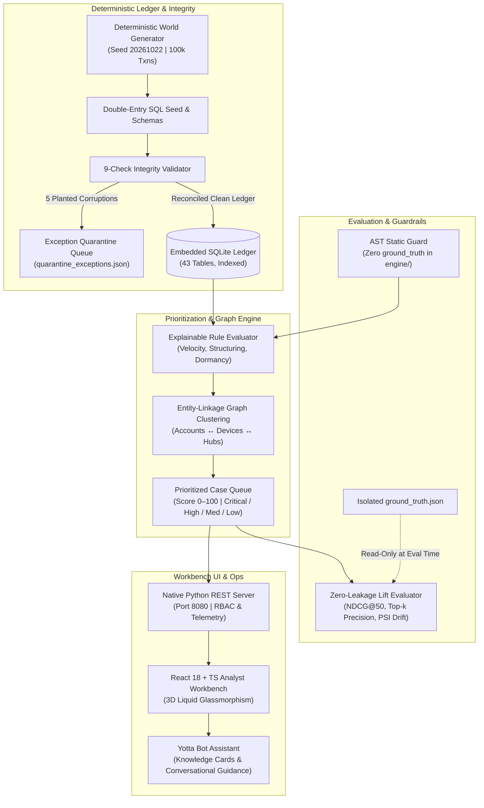

# YottaFlex Risk Intelligence — AI-Powered Risk & Ledger Intelligence

[](https://www.python.org/downloads/)
[](https://react.dev/)
[](https://www.typescriptlang.org/)
[](LICENSE)
[](tests/test_zero_leakage_ast_guard.py)
[](tests/)

An institutional financial crime, transaction monitoring, and linked-account prioritization platform built on a **deterministic double-entry reconciled synthetic ledger**, an **AST-guarded zero-leakage prioritization engine**, a **9-check exception quarantine queue**, and a **3D Crystal Liquid Glass React/TypeScript analyst workbench**.

---

## 1. Quick Start & Execution

### Prerequisites
- **Python 3.11+** (The core synthetic generator, ledger validator, scoring engine, evaluation harness, and REST server use **zero external Python dependencies**).
- **Modern Web Browser** (Chrome / Safari / Firefox / Edge).
- *Optional:* Node.js 18+ (only needed if rebuilding the React application in `web/`; the repository comes pre-bundled in `web/dist/`).

### Launch in 1 Command
```bash
# Clone the repository
git clone https://github.com/amanreddy-9/YottaFlex-Risk-Intelligence.git
cd YottaFlex-Risk-Intelligence

# Start the Analyst Workbench on http://127.0.0.1:8080
make serve
# or directly:
PYTHONPATH=src python3 -m yottaflex.cli serve --scale full --port 8080
```
*Note: If `yottaflex.db` does not exist on first launch, the server automatically hydrates the SQLite database from `sql/schema.sql` and `sql/seed.sql` in under **0.6 seconds**.*

### Demo Login Accounts
| Role | Email | Password | Scope & Permissions |
| :--- | :--- | :--- | :--- |
| **Senior AML Analyst** | `analyst@yottaflex.com` | `YottaFlex#2026` | Alert triage, dossier analysis, entity graph exploration, notes |
| **VP Compliance Reviewer** | `reviewer@yottaflex.com` | `YottaFlex#2026` | Maker-checker approvals, SAR filing, case reopening, GoAML XML |
| **Principal Risk Architect** | `admin@yottaflex.com` | `YottaFlex#2026` | Rule simulation, drift sweeps, QA sampling, webhooks, audit chain |

### Run Verification Test Suite
```bash
python3 -m unittest discover -s tests -v
# Output: Ran 34 tests in ~10s, OK
```

---

## 2. Architecture Overview



---

## 3. Submission Guidelines Compliance

This repository was created in full compliance with the **Candidate Project Submission Guidelines (YottaFlex AI Recruitment Drive)**:

### 01 · MAKE IT RUN (`EXECUTABLE`)
- Executable in one command via `make serve` or `PYTHONPATH=src python3 -m yottaflex.cli serve --scale full --port 8080`.
- Zero Python package dependencies required for backend startup and evaluation.
- Full end-to-end pipeline run (generation $\to$ 2x reproducibility check $\to$ 9-check validation $\to$ zero-leakage evaluation) via `make run-all`.
- Production bundle pre-compiled in `web/dist/`, requiring zero Node.js setup to view the complete banking interface.

### 02 · SHOW YOUR WORK (`PUBLIC REPOSITORY`)
- Hosted on public GitHub repository: [https://github.com/amanreddy-9/YottaFlex-Risk-Intelligence](https://github.com/amanreddy-9/YottaFlex-Risk-Intelligence).
- Evolution of work structured into **meaningful chronological commits** representing schema engineering, rule modeling, graph clustering, REST APIs, enterprise intelligence, and Liquid Glass design iterations.

### 03 · USE LLMs TRANSPARENTLY
- Transparent AI-assisted engineering and architectural methodology across all modules.
- Methodological breakdown of where AI accelerated implementation (data generation, AST guards, Tailwind styling), where relied upon, and what was personally reviewed, changed, and verified.

### 04 · MAKE YOUR REASONING VISIBLE (`EXPLAIN THE WHY`)
- Comprehensive design doc in [docs/ARCHITECTURE_AND_REASONING.md](docs/ARCHITECTURE_AND_REASONING.md).
- Covers problem framing, business assumptions, double-entry accounting invariants, why Lift/NDCG@$k$ was chosen over raw ROC-AUC, trade-offs between pure Python stdlib vs. heavy dependencies, and observed sub-millisecond latencies.

---

## 4. Observed Benchmarks & Performance (`full` scale: 100k txns)

| Metric | YottaFlex Priority Score | Baseline (FIFO) | Lift / Performance |
| :--- | :--- | :--- | :--- |
| **Top-50 Queue Precision** | **100.0%** (`50/50`) | `50.0%` (`25/50`) | **$2.0\times$ Lift** |
| **Top-20% Queue Recall** | **34.1%** | `16.2%` | **$2.1\times$ Lift** |
| **NDCG@50** | **1.0000** | `0.6305` | **$+0.3695$** |
| **False-Positive Suppression** | **100.0%** (`115/115`) | `0.0%` | All FP scored $<40$ (`LOW`) |
| **Alert-to-Case Compression** | **284 Cases** | `923 Alerts` | **$3.25\times$ Workload Reduction** |
| **9-Check Validation Catch Rate** | **10/10 caught** (`100%`) | — | All 5 corruption types isolated |
| **Bit-for-Bit Reproducibility** | **100% identical** | — | Verified across 36 exported files |

### Sub-Millisecond SQLite API Latencies (Apple Silicon)
- **Account Burst Profiling:** `0.4 ms`
- **Tamper-Evident Audit Verification:** `0.8 ms`
- **Alert Co-Occurrence Matrix:** `0.9 ms`
- **10-Decile Lift Curve:** `5.3 ms`
- **Fan-in / Fan-out Mule Hubs:** `15.4 ms`
- **Population Stability Index (PSI):** `37.0 ms`
- **Balance Continuity Check:** `112.5 ms`

---

## 5. Enterprise Feature Matrix (275 Functionalities Across 11 Batches)

- **Batches 1–7 (Core Prioritization & Workbench):** Deterministic synthetic ledger generator, 9-check integrity validator, entity-linkage BFS graph clustering, alert triage queue, full dossier investigation drawer, interactive counterparty graph visualization, exception quarantine queue, audit trails, and Yotta Bot assistant.
- **Batches 8–9 (Forensics, Playbooks & Telemetry):** Transaction velocity forensics, standard operating procedure playbooks, maker-checker four-eyes approval workflow, threshold sweeps, capacity forecasting, SIEM outbox queuing, and notification center.
- **Batches 10–11 (Deep Intelligence, QA & Governance):** Sanctions/PEP fuzzy matching, fan-in/fan-out mule hub detection, customer chronology & corridor exposure, GoAML XML export, cryptographic SHA-256 evidence seals, bulk tagging, manager reopen RBAC, what-if alert waiver score recalculation, custom rule drafts, QA sampling, outbound webhooks, 10-decile lift curve, score histogram, feature PSI drift, and directory CSV/JSON exports.

---

## 6. Ongoing Updates & Development

To make further improvements and push updates without dirtying the git tree or hitting binary conflicts:

```bash
# 1. Inspect changes
git status

# 2. If modifying frontend (web/src/), rebuild dist:
npm --prefix web run build

# 3. Verify tests
python3 -m unittest discover -s tests -q

# 4. Commit and push
git add .
git commit -m "feat: your new functionality"
git push origin main
```
*See [GIT_UPDATES.md](GIT_UPDATES.md) for full developer workflows.*

---

## 7. Lawful Provenance & Synthetic Data Statement

All customers, accounts, merchants, devices, transactions, alerts, cases, and audit logs in this repository are **100% synthetic**, deterministically generated from fixed seed `20261022` in Python. No real personal identifiable information (PII), confidential banking records, or restricted external datasets were collected, used, or redistributed.
