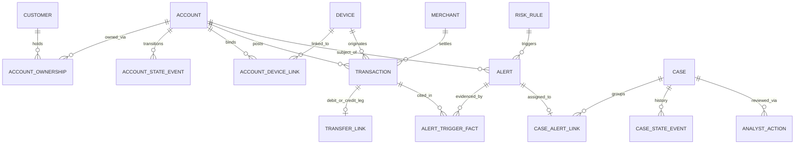

# YottaFlex Relational Schema & Data Dictionary

**Schema Version:** `1.0.0`  
**Core Entities:** `Customer`, `Account`, `Merchant`, `Device`, `Transaction`, `TransferLink`, `RiskRule`, `Alert`, `Case`, `AnalystAction`  
**Bridge & Event History Tables:** `AccountOwnership`, `AccountDeviceLink`, `AccountStateEvent`, `AlertTriggerFact`, `CaseAlertLink`, `CaseStateEvent`  

## 1. Entity-Relationship Overview

## 2. ID & Nomenclature Conventions

| Entity | Pattern | Example |
| :--- | :--- | :--- |
| Customer | `CUS-000001` | `CUS-000042` |
| Account | `ACC-<customer-id>-01` | `ACC-CUS-000042-01` |
| Transaction | `TXN-2026-00000001` | `TXN-2026-00014250` |
| TransferLink | `TRL-2026-000001` | `TRL-2026-000812` |
| Alert | `ALT-2026-000001` | `ALT-2026-000319` |
| Case | `CASE-2026-000001` | `CASE-2026-000105` |
| AnalystAction | `ACT-2026-000001` | `ACT-2026-000088` |
| Bridge / Events | `OWN-`, `ADL-`, `ASE-2026-`, `ATF-2026-`, `CAL-2026-`, `CSE-2026-` | `ASE-2026-000001` |

## 3. Lifecycle State Machines

- **Account:** `ACTIVE <-> DORMANT -> FROZEN -> CLOSED` (recorded immutably in `account_state_events`).
- **Case:** `OPEN -> IN_REVIEW -> ESCALATED | SAR_FILED | CLOSED_CONFIRMED_FRAUD | CLOSED_FALSE_POSITIVE` (recorded immutably in `case_state_events`).

## 4. Table-by-Table Data Dictionary

### Customer (`customers`) — *Master*

Registered account holder and KYC profile master table.

- **Primary Key:** `customer_id` (`^CUS-\d{6}$`)
- **Lifecycle:** ACTIVE -> RESTRICTED -> OFFBOARDED
- **Effective Dates:** `kyc_verified_at, created_at`
- **Relationships & Cardinality:**
  - Customer N:M Account via AccountOwnership (1 customer owns >=1 accounts; joint accounts link >=2 customers)
  - Customer 1:N Alert (optional direct attribution via primary owner)

| Field | Type | Req | Allowed Values / Domain | Units | Uniqueness | Validation Rule | Description |
| :--- | :--- | :---: | :--- | :--- | :--- | :--- | :--- |
| `customer_id` | `string` | Yes | CUS-000001 .. CUS-999999 | none | PRIMARY KEY | Matches ^CUS-\d{6}$ | Immutable deterministic customer identifier. |
| `full_name` | `string` | Yes | Non-empty synthetic full name | none | NON-UNIQUE | Length 3..120 | Synthetic customer full name. |
| `email` | `string` | Yes | Synthetic email address | none | UNIQUE | Valid email format | Synthetic customer email address. |
| `phone` | `string` | Yes | Synthetic E.164 phone | none | NON-UNIQUE | Matches ^\+1-555-\d{3}-\d{4}$ | Synthetic customer contact phone number. |
| `segment` | `enum` | Yes | RETAIL \| AFFLUENT \| SMB | none | NON-UNIQUE | In allowed segment enum | Customer banking segment. |
| `kyc_tier` | `enum` | Yes | LOW \| STANDARD \| ENHANCED | none | NON-UNIQUE | In allowed kyc_tier enum | Identity verification level. |
| `kyc_verified_at` | `datetime` | Yes | UTC ISO-8601 | UTC ISO-8601 | NON-UNIQUE | kyc_verified_at >= created_at | Timestamp when KYC profile was verified. |
| `declared_annual_income` | `decimal(14,2)` | Yes | >= 12000.00 | USD | NON-UNIQUE | declared_annual_income > 0 | Self-declared annual income used for deviation rules. |
| `home_country` | `string` | Yes | ISO-3166 alpha-2 (US, CA, GB, DE, SG, IN, BR, MX, AE) | country code | NON-UNIQUE | 2 uppercase ASCII letters | Primary tax/residency country. |
| `risk_rating` | `enum` | Yes | LOW \| MEDIUM \| HIGH | none | NON-UNIQUE | In allowed risk_rating enum | Baseline onboarding KYC risk rating. |
| `status` | `enum` | Yes | ACTIVE \| RESTRICTED \| OFFBOARDED | none | NON-UNIQUE | In allowed customer_status enum | Current customer relationship status. |
| `created_at` | `datetime` | Yes | UTC ISO-8601 | UTC ISO-8601 | NON-UNIQUE | Valid ISO-8601 <= 2026-10-28T23:59:59Z | Customer onboarding timestamp. |

### Account (`accounts`) — *Master*

Financial ledger account with ownership, overdraft policy, and derived reconciled balance.

- **Primary Key:** `account_id` (`^ACC-CUS-\d{6}-\d{2}$`)
- **Lifecycle:** ACTIVE <-> DORMANT -> FROZEN -> CLOSED
- **Effective Dates:** `opened_at, closed_at (optional)`
- **Relationships & Cardinality:**
  - Account N:1 primary Customer (primary_customer_id)
  - Account N:M Customer via AccountOwnership (supports joint accounts)
  - Account 1:N AccountStateEvent (append-only lifecycle history)
  - Account 1:N Transaction (ordered financial ledger)
  - Account N:M Device via AccountDeviceLink

| Field | Type | Req | Allowed Values / Domain | Units | Uniqueness | Validation Rule | Description |
| :--- | :--- | :---: | :--- | :--- | :--- | :--- | :--- |
| `account_id` | `string` | Yes | ACC-CUS-000001-01 | none | PRIMARY KEY | Matches ^ACC-CUS-\d{6}-\d{2}$ | Immutable deterministic account identifier. |
| `primary_customer_id` | `string` | Yes | Existing CUS-XXXXXX | none | NON-UNIQUE | FK -> customers.customer_id | Primary owning customer ID. |
| `account_type` | `enum` | Yes | CHECKING \| SAVINGS \| BUSINESS | none | NON-UNIQUE | In allowed account_type enum | Account product category. |
| `currency` | `string` | Yes | USD | ISO-4217 | NON-UNIQUE | Equals 'USD' | Account settlement currency. |
| `status` | `enum` | Yes | ACTIVE \| DORMANT \| FROZEN \| CLOSED | none | NON-UNIQUE | Matches latest AccountStateEvent.new_status | Latest derived account lifecycle state. |
| `overdraft_allowed` | `boolean` | Yes | 0 \| 1 | flag (0/1) | NON-UNIQUE | In {0, 1} | Whether negative balance up to overdraft_limit is permitted. |
| `overdraft_limit` | `decimal(14,2)` | Yes | >= 0.00 | USD | NON-UNIQUE | 0.00 if overdraft_allowed=0 else > 0 | Maximum permitted negative balance. |
| `opening_balance` | `decimal(14,2)` | Yes | >= 0.00 | USD | NON-UNIQUE | opening_balance >= 0 | Initial funded balance at account opening. |
| `current_balance` | `decimal(14,2)` | Yes | Derived from ledger | USD | NON-UNIQUE | Equals opening_balance + sum(posted signed txns) | Reconciled ending balance. |
| `opened_at` | `datetime` | Yes | UTC ISO-8601 | UTC ISO-8601 | NON-UNIQUE | opened_at >= primary customer created_at | Account opening timestamp. |
| `closed_at` | `datetime` | No | UTC ISO-8601 or NULL | UTC ISO-8601 | NON-UNIQUE | NULL unless status='CLOSED'; closed_at >= opened_at | Optional closure timestamp. |

### AccountOwnership (`account_ownerships`) — *Bridge*

Many-to-many bridge linking customers to primary and joint accounts.

- **Primary Key:** `ownership_id` (`^OWN-\d{6}$`)
- **Lifecycle:** Effective interval [effective_from, effective_to]
- **Effective Dates:** `effective_from, effective_to (optional)`
- **Relationships & Cardinality:**
  - Bridge resolving N:M Customer <-> Account ownership with effective date range

| Field | Type | Req | Allowed Values / Domain | Units | Uniqueness | Validation Rule | Description |
| :--- | :--- | :---: | :--- | :--- | :--- | :--- | :--- |
| `ownership_id` | `string` | Yes | OWN-000001 .. | none | PRIMARY KEY | Matches ^OWN-\d{6}$ | Bridge primary key. |
| `account_id` | `string` | Yes | Existing ACC-... | none | NON-UNIQUE | FK -> accounts.account_id | Owned account. |
| `customer_id` | `string` | Yes | Existing CUS-... | none | NON-UNIQUE | FK -> customers.customer_id | Owning customer. |
| `ownership_role` | `enum` | Yes | PRIMARY \| JOINT \| AUTHORIZED_SIGNER | none | NON-UNIQUE | In allowed ownership_role enum | Role of customer on the account. |
| `ownership_pct` | `decimal(5,2)` | Yes | 0.00 .. 100.00 | percent | NON-UNIQUE | 0 < ownership_pct <= 100 | Ownership share percentage. |
| `effective_from` | `datetime` | Yes | UTC ISO-8601 | UTC ISO-8601 | NON-UNIQUE | effective_from >= account.opened_at | Start of ownership relationship. |
| `effective_to` | `datetime` | No | UTC ISO-8601 or NULL | UTC ISO-8601 | NON-UNIQUE | NULL or effective_to >= effective_from | Optional end of ownership relationship. |

### Merchant (`merchants`) — *Master*

Synthetic merchant directory with MCC codes, geography, and risk tiers.

- **Primary Key:** `merchant_id` (`^MER-\d{6}$`)
- **Lifecycle:** Static master reference with risk_tier
- **Effective Dates:** `registered_at`
- **Relationships & Cardinality:**
  - Merchant 1:N Transaction (optional; only merchant-facing purchases)

| Field | Type | Req | Allowed Values / Domain | Units | Uniqueness | Validation Rule | Description |
| :--- | :--- | :---: | :--- | :--- | :--- | :--- | :--- |
| `merchant_id` | `string` | Yes | MER-000001 .. | none | PRIMARY KEY | Matches ^MER-\d{6}$ | Immutable deterministic merchant identifier. |
| `merchant_name` | `string` | Yes | Non-empty synthetic name | none | NON-UNIQUE | Length 2..120 | Synthetic merchant DBA name. |
| `mcc` | `string` | Yes | 4-digit MCC string | MCC | NON-UNIQUE | Matches ^\d{4}$ | Merchant Category Code. |
| `category` | `string` | Yes | GROCERY \| UTILITIES \| TRAVEL \| RETAIL \| ELECTRONICS \| CRYPTO_EXCHANGE \| GAMING \| LUXURY \| EDUCATION \| HEALTHCARE | none | NON-UNIQUE | Non-empty category | Human-readable merchant sector. |
| `country` | `string` | Yes | ISO-3166 alpha-2 | country code | NON-UNIQUE | 2 uppercase ASCII letters | Merchant settlement jurisdiction. |
| `risk_tier` | `enum` | Yes | LOW \| MEDIUM \| HIGH | none | NON-UNIQUE | In allowed merchant_risk_tier enum | Inherent merchant AML/fraud risk tier. |
| `is_high_risk_mcc` | `boolean` | Yes | 0 \| 1 | flag (0/1) | NON-UNIQUE | In {0, 1} | Flag for elevated-risk MCC sectors (crypto, gaming, luxury). |
| `registered_at` | `datetime` | Yes | UTC ISO-8601 | UTC ISO-8601 | NON-UNIQUE | Valid ISO-8601 | Merchant onboarding timestamp. |

### Device (`devices`) — *Master*

Endpoint device fingerprint catalog used to detect new-device and shared-mule-device rings.

- **Primary Key:** `device_id` (`^DEV-\d{6}$`)
- **Lifecycle:** Active fingerprint with emulator/VPN risk attributes
- **Effective Dates:** `first_observed_at`
- **Relationships & Cardinality:**
  - Device N:M Account via AccountDeviceLink
  - Device 1:N Transaction (optional; digital channel transactions)

| Field | Type | Req | Allowed Values / Domain | Units | Uniqueness | Validation Rule | Description |
| :--- | :--- | :---: | :--- | :--- | :--- | :--- | :--- |
| `device_id` | `string` | Yes | DEV-000001 .. | none | PRIMARY KEY | Matches ^DEV-\d{6}$ | Immutable deterministic device identifier. |
| `device_fingerprint` | `string` | Yes | 32-char hex digest | none | UNIQUE | Matches ^[a-f0-9]{32}$ | Unique deterministic hardware/browser fingerprint. |
| `os_family` | `enum` | Yes | iOS \| Android \| Windows \| macOS \| Linux | none | NON-UNIQUE | In allowed device_os enum | Operating system family. |
| `is_emulator` | `boolean` | Yes | 0 \| 1 | flag (0/1) | NON-UNIQUE | In {0, 1} | True if virtualized/emulator environment detected. |
| `ip_country` | `string` | Yes | ISO-3166 alpha-2 | country code | NON-UNIQUE | 2 uppercase ASCII letters | Primary observed IP country. |
| `risk_tier` | `enum` | Yes | LOW \| MEDIUM \| HIGH | none | NON-UNIQUE | In allowed device_risk_tier enum | Baseline device risk classification. |
| `first_observed_at` | `datetime` | Yes | UTC ISO-8601 | UTC ISO-8601 | NON-UNIQUE | Valid ISO-8601 | First global sighting of device. |

### AccountDeviceLink (`account_device_links`) — *Bridge*

Many-to-many association tracking when each device was bound to or used on each account.

- **Primary Key:** `link_id` (`^ADL-\d{6}$`)
- **Lifecycle:** TRUSTED | UNVERIFIED | FLAGGED_SHARED
- **Effective Dates:** `first_seen_at, last_seen_at`
- **Relationships & Cardinality:**
  - Bridge resolving N:M Account <-> Device bindings

| Field | Type | Req | Allowed Values / Domain | Units | Uniqueness | Validation Rule | Description |
| :--- | :--- | :---: | :--- | :--- | :--- | :--- | :--- |
| `link_id` | `string` | Yes | ADL-000001 .. | none | PRIMARY KEY | Matches ^ADL-\d{6}$ | Bridge primary key. |
| `account_id` | `string` | Yes | Existing ACC-... | none | NON-UNIQUE | FK -> accounts.account_id | Associated account. |
| `device_id` | `string` | Yes | Existing DEV-... | none | NON-UNIQUE | FK -> devices.device_id | Associated device. |
| `first_seen_at` | `datetime` | Yes | UTC ISO-8601 | UTC ISO-8601 | NON-UNIQUE | first_seen_at >= account.opened_at | First usage timestamp on this account. |
| `last_seen_at` | `datetime` | Yes | UTC ISO-8601 | UTC ISO-8601 | NON-UNIQUE | last_seen_at >= first_seen_at | Most recent usage timestamp on this account. |
| `is_trusted` | `boolean` | Yes | 0 \| 1 | flag (0/1) | NON-UNIQUE | In {0, 1} | Whether device completed MFA / long-standing trust. |

### AccountStateEvent (`account_state_events`) — *History*

Immutable append-only audit log of account lifecycle state changes.

- **Primary Key:** `event_id` (`^ASE-2026-\d{6}$`)
- **Lifecycle:** OPENED(NULL)->ACTIVE, ACTIVE->DORMANT, DORMANT->ACTIVE, ACTIVE->CLOSED
- **Effective Dates:** `effective_at`
- **Relationships & Cardinality:**
  - Account 1:N AccountStateEvent (append-only state transitions)

| Field | Type | Req | Allowed Values / Domain | Units | Uniqueness | Validation Rule | Description |
| :--- | :--- | :---: | :--- | :--- | :--- | :--- | :--- |
| `event_id` | `string` | Yes | ASE-2026-000001 .. | none | PRIMARY KEY | Matches ^ASE-2026-\d{6}$ | Immutable state event ID. |
| `account_id` | `string` | Yes | Existing ACC-... | none | NON-UNIQUE | FK -> accounts.account_id | Target account. |
| `prev_status` | `enum` | No | NULL \| ACTIVE \| DORMANT \| FROZEN \| CLOSED | none | NON-UNIQUE | NULL on initial opening else valid account_status | Status prior to transition. |
| `new_status` | `enum` | Yes | ACTIVE \| DORMANT \| FROZEN \| CLOSED | none | NON-UNIQUE | In allowed account_status enum | Status after transition. |
| `effective_at` | `datetime` | Yes | UTC ISO-8601 | UTC ISO-8601 | NON-UNIQUE | Monotonic per account | Timestamp transition became effective. |
| `reason` | `string` | Yes | ACCOUNT_OPENING \| INACTIVITY_90D \| REACTIVATION_ACTIVITY \| CUSTOMER_CLOSURE \| RISK_FREEZE | none | NON-UNIQUE | Non-empty reason code | Business reason for transition. |
| `actor_id` | `string` | Yes | SYSTEM \| CUS-... \| ADM-... | none | NON-UNIQUE | Non-empty actor | System or user executing transition. |

### Transaction (`transactions`) — *Ledger*

Timestamped financial ledger event with reconciled before/after balances.

- **Primary Key:** `transaction_id` (`^TXN-2026-\d{8}$`)
- **Lifecycle:** POSTED | REVERSED | FAILED
- **Effective Dates:** `occurred_at`
- **Relationships & Cardinality:**
  - Transaction N:1 Account (mandatory)
  - Transaction N:1 Merchant (optional; NULL for transfers/ATM/payroll)
  - Transaction N:1 Device (optional; NULL for branch/ATM/ACH batch)
  - Transaction 1:1 TransferLink leg (optional; for paired transfers)
  - Transaction N:M Alert via AlertTriggerFact

| Field | Type | Req | Allowed Values / Domain | Units | Uniqueness | Validation Rule | Description |
| :--- | :--- | :---: | :--- | :--- | :--- | :--- | :--- |
| `transaction_id` | `string` | Yes | TXN-2026-00000001 .. | none | PRIMARY KEY | Matches ^TXN-2026-\d{8}$ | Immutable deterministic transaction identifier. |
| `account_id` | `string` | Yes | Existing ACC-... | none | NON-UNIQUE | FK -> accounts.account_id | Ledger account impacted. |
| `txn_type` | `enum` | Yes | PAYROLL_CREDIT \| MERCHANT_PURCHASE \| ATM_WITHDRAWAL \| INTERNAL_TRANSFER_OUT \| INTERNAL_TRANSFER_IN \| P2P_TRANSFER_OUT \| P2P_TRANSFER_IN \| WIRE_OUT \| WIRE_IN \| FEE | none | NON-UNIQUE | In allowed txn_type enum | Transaction classification. |
| `direction` | `enum` | Yes | DEBIT \| CREDIT | none | NON-UNIQUE | DEBIT or CREDIT | Balance direction. |
| `amount` | `decimal(14,2)` | Yes | > 0.00 | USD | NON-UNIQUE | amount > 0 | Unsigned transaction amount. |
| `currency` | `string` | Yes | USD | ISO-4217 | NON-UNIQUE | Equals 'USD' | Transaction currency. |
| `balance_before` | `decimal(14,2)` | Yes | Derived running balance | USD | NON-UNIQUE | Matches prior transaction balance_after | Account balance immediately before transaction. |
| `balance_after` | `decimal(14,2)` | Yes | Derived running balance | USD | NON-UNIQUE | balance_before + signed_amount (if POSTED) | Account balance immediately after transaction. |
| `channel` | `enum` | Yes | MOBILE_APP \| WEB \| POS \| ATM \| WIRE \| ACH | none | NON-UNIQUE | In allowed txn_channel enum | Origination channel. |
| `merchant_id` | `string` | No | Existing MER-... or NULL | none | NON-UNIQUE | NULL or FK -> merchants.merchant_id | Optional counterparty merchant. |
| `device_id` | `string` | No | Existing DEV-... or NULL | none | NON-UNIQUE | NULL or FK -> devices.device_id | Optional originating device. |
| `counterparty_country` | `string` | Yes | ISO-3166 alpha-2 | country code | NON-UNIQUE | 2 uppercase ASCII letters | Jurisdiction of counterparty/terminal. |
| `status` | `enum` | Yes | POSTED \| REVERSED \| FAILED | none | NON-UNIQUE | In allowed txn_status enum | Posting status. |
| `occurred_at` | `datetime` | Yes | UTC ISO-8601 | UTC ISO-8601 | NON-UNIQUE | occurred_at >= account.opened_at | Exact transaction UTC timestamp. |
| `reference_note` | `string` | Yes | Descriptive synthetic memo | none | NON-UNIQUE | Non-empty memo | Transaction memo / narrative. |

### TransferLink (`transfer_links`) — *Ledger*

Explicit double-entry transfer bridge pairing outbound debit and inbound credit legs.

- **Primary Key:** `transfer_id` (`^TRL-2026-\d{6}$`)
- **Lifecycle:** SETTLED | MISMATCHED | INCOMPLETE
- **Effective Dates:** `initiated_at, settled_at (optional)`
- **Relationships & Cardinality:**
  - TransferLink N:1 source Account & debit Transaction
  - TransferLink N:1 dest Account & optional credit Transaction (NULL only on injected incomplete-leg exception)

| Field | Type | Req | Allowed Values / Domain | Units | Uniqueness | Validation Rule | Description |
| :--- | :--- | :---: | :--- | :--- | :--- | :--- | :--- |
| `transfer_id` | `string` | Yes | TRL-2026-000001 .. | none | PRIMARY KEY | Matches ^TRL-2026-\d{6}$ | Immutable transfer link ID. |
| `debit_txn_id` | `string` | Yes | Existing TXN-... | none | UNIQUE | FK -> transactions.transaction_id (DEBIT) | Outbound debit transaction leg. |
| `credit_txn_id` | `string` | No | Existing TXN-... or NULL | none | NON-UNIQUE | NULL only on INCOMPLETE exception; else FK -> transactions.transaction_id (CREDIT) | Inbound credit transaction leg. |
| `source_account_id` | `string` | Yes | Existing ACC-... | none | NON-UNIQUE | FK -> accounts.account_id | Originating account. |
| `dest_account_id` | `string` | Yes | Existing ACC-... | none | NON-UNIQUE | FK -> accounts.account_id; != source_account_id | Receiving account. |
| `transfer_amount` | `decimal(14,2)` | Yes | > 0.00 | USD | NON-UNIQUE | Equals debit_txn.amount and credit_txn.amount when SETTLED | Expected transfer principal. |
| `is_same_customer` | `boolean` | Yes | 0 \| 1 | flag (0/1) | NON-UNIQUE | In {0, 1} | Derived indicator: source and dest share an owner. |
| `status` | `enum` | Yes | SETTLED \| MISMATCHED \| INCOMPLETE | none | NON-UNIQUE | In allowed transfer_status enum | Reconciliation status of transfer pair. |
| `initiated_at` | `datetime` | Yes | UTC ISO-8601 | UTC ISO-8601 | NON-UNIQUE | Equals debit_txn.occurred_at | Transfer initiation timestamp. |
| `settled_at` | `datetime` | No | UTC ISO-8601 or NULL | UTC ISO-8601 | NON-UNIQUE | settled_at >= initiated_at when present | Transfer settlement timestamp. |

### RiskRule (`risk_rules`) — *Rule*

Transparent, versioned AML/fraud detection rules with explicit thresholds and priority weights.

- **Primary Key:** `rule_id` (`^RULE-\d{3}$`)
- **Lifecycle:** ACTIVE | RETIRED (versioned)
- **Effective Dates:** `effective_from`
- **Relationships & Cardinality:**
  - RiskRule 1:N Alert (transparent rule definition powering each alert)
  - RiskRule 1:N AlertTriggerFact

| Field | Type | Req | Allowed Values / Domain | Units | Uniqueness | Validation Rule | Description |
| :--- | :--- | :---: | :--- | :--- | :--- | :--- | :--- |
| `rule_id` | `string` | Yes | RULE-001 .. RULE-999 | none | PRIMARY KEY | Matches ^RULE-\d{3}$ | Rule identifier. |
| `rule_name` | `string` | Yes | Non-empty name | none | UNIQUE | Length 3..100 | Human-readable rule title. |
| `category` | `enum` | Yes | VELOCITY \| DEVICE \| NETWORK \| LIFECYCLE \| GEO_MERCHANT \| STRUCTURING \| KYC_DEVIATION | none | NON-UNIQUE | In allowed rule_category enum | Detection typology family. |
| `severity` | `enum` | Yes | LOW \| MEDIUM \| HIGH \| CRITICAL | none | NON-UNIQUE | In allowed severity enum | Default severity tier. |
| `base_weight` | `integer` | Yes | 1 .. 100 | points | NON-UNIQUE | 1 <= base_weight <= 100 | Base priority score weight. |
| `threshold_desc` | `string` | Yes | Explicit formula/threshold | none | NON-UNIQUE | Non-empty | Transparent threshold specification. |
| `is_active` | `boolean` | Yes | 0 \| 1 | flag (0/1) | NON-UNIQUE | In {0, 1} | Whether rule is active. |
| `version` | `string` | Yes | v1.0 .. | none | NON-UNIQUE | Semver-like string | Rule version. |
| `effective_from` | `datetime` | Yes | UTC ISO-8601 | UTC ISO-8601 | NON-UNIQUE | Valid ISO-8601 | Rule activation timestamp. |

### Alert (`alerts`) — *Detection*

Rule-generated risk alert with explainable score and traceability to triggering facts.

- **Primary Key:** `alert_id` (`^ALT-2026-\d{6}$`)
- **Lifecycle:** OPEN -> GROUPED -> RESOLVED | DISMISSED
- **Effective Dates:** `created_at`
- **Relationships & Cardinality:**
  - Alert N:1 RiskRule
  - Alert N:1 Account & N:1 Customer
  - Alert N:1 triggering Transaction (optional ONLY for injected orphan-alert edge case)
  - Alert N:M Transaction/TransferLink via AlertTriggerFact
  - Alert N:M Case via CaseAlertLink

| Field | Type | Req | Allowed Values / Domain | Units | Uniqueness | Validation Rule | Description |
| :--- | :--- | :---: | :--- | :--- | :--- | :--- | :--- |
| `alert_id` | `string` | Yes | ALT-2026-000001 .. | none | PRIMARY KEY | Matches ^ALT-2026-\d{6}$ | Immutable deterministic alert identifier. |
| `rule_id` | `string` | Yes | Existing RULE-XXX | none | NON-UNIQUE | FK -> risk_rules.rule_id | Rule that fired. |
| `account_id` | `string` | Yes | Existing ACC-... | none | NON-UNIQUE | FK -> accounts.account_id | Subject account. |
| `customer_id` | `string` | Yes | Existing CUS-... | none | NON-UNIQUE | FK -> customers.customer_id | Primary subject customer. |
| `primary_txn_id` | `string` | No | Existing TXN-... or NULL | none | NON-UNIQUE | NULL only on ORPHAN_ALERT_NO_TRIGGER exception; else FK -> transactions.transaction_id | Anchor triggering transaction. |
| `severity` | `enum` | Yes | LOW \| MEDIUM \| HIGH \| CRITICAL | none | NON-UNIQUE | In allowed severity enum | Alert severity level. |
| `risk_score` | `decimal(5,2)` | Yes | 0.00 .. 100.00 | points (0-100) | NON-UNIQUE | 0 <= risk_score <= 100 | Derived explainable alert score. |
| `trigger_txn_count` | `integer` | Yes | >= 0 | count | NON-UNIQUE | Matches count of AlertTriggerFact rows | Number of supporting transactions. |
| `trigger_total_amount` | `decimal(14,2)` | Yes | >= 0.00 | USD | NON-UNIQUE | Derived sum of triggering exposure | Total dollar volume tied to alert. |
| `explanation_summary` | `string` | Yes | Transparent reason string | none | NON-UNIQUE | Non-empty explanation | Human-readable explanation of rule trigger. |
| `status` | `enum` | Yes | OPEN \| GROUPED \| RESOLVED \| DISMISSED | none | NON-UNIQUE | In allowed alert_status enum | Current alert lifecycle state. |
| `created_at` | `datetime` | Yes | UTC ISO-8601 | UTC ISO-8601 | NON-UNIQUE | created_at >= primary_txn.occurred_at when present | Timestamp alert was generated. |

### AlertTriggerFact (`alert_trigger_facts`) — *Bridge*

Fact-level audit bridge linking every alert to the exact transactions and quantitative thresholds that triggered it.

- **Primary Key:** `fact_id` (`^ATF-2026-\d{6}$`)
- **Lifecycle:** Immutable evidence record
- **Effective Dates:** `recorded_at`
- **Relationships & Cardinality:**
  - Bridge resolving N:M Alert <-> Transaction (and optional TransferLink) with exact metrics

| Field | Type | Req | Allowed Values / Domain | Units | Uniqueness | Validation Rule | Description |
| :--- | :--- | :---: | :--- | :--- | :--- | :--- | :--- |
| `fact_id` | `string` | Yes | ATF-2026-000001 .. | none | PRIMARY KEY | Matches ^ATF-2026-\d{6}$ | Bridge primary key. |
| `alert_id` | `string` | Yes | Existing ALT-... | none | NON-UNIQUE | FK -> alerts.alert_id | Parent alert. |
| `transaction_id` | `string` | Yes | Existing TXN-... | none | NON-UNIQUE | FK -> transactions.transaction_id | Supporting transaction. |
| `transfer_id` | `string` | No | Existing TRL-... or NULL | none | NON-UNIQUE | NULL or FK -> transfer_links.transfer_id | Optional supporting transfer link. |
| `rule_id` | `string` | Yes | Existing RULE-... | none | NON-UNIQUE | FK -> risk_rules.rule_id | Rule evaluated. |
| `metric_name` | `string` | Yes | window_txn_count \| device_age_hours \| cycle_return_ratio \| dormancy_days \| ... | none | NON-UNIQUE | Non-empty | Quantitative indicator measured. |
| `observed_value` | `string` | Yes | Numeric or descriptor | mixed | NON-UNIQUE | Non-empty | Measured value that breached threshold. |
| `threshold_value` | `string` | Yes | Numeric or descriptor | mixed | NON-UNIQUE | Non-empty | Rule threshold exceeded. |
| `recorded_at` | `datetime` | Yes | UTC ISO-8601 | UTC ISO-8601 | NON-UNIQUE | Equals alert.created_at | Fact capture timestamp. |

### Case (`cases`) — *Triage*

Grouped investigation dossier aggregating linked alerts, accounts, and explainable priority score.

- **Primary Key:** `case_id` (`^CASE-2026-\d{6}$`)
- **Lifecycle:** OPEN -> IN_REVIEW -> ESCALATED | SAR_FILED | CLOSED_CONFIRMED_FRAUD | CLOSED_FALSE_POSITIVE
- **Effective Dates:** `created_at, updated_at`
- **Relationships & Cardinality:**
  - Case N:M Alert via CaseAlertLink
  - Case 1:N CaseStateEvent (append-only lifecycle history)
  - Case 1:N AnalystAction (append-only analyst decisions)

| Field | Type | Req | Allowed Values / Domain | Units | Uniqueness | Validation Rule | Description |
| :--- | :--- | :---: | :--- | :--- | :--- | :--- | :--- |
| `case_id` | `string` | Yes | CASE-2026-000001 .. | none | PRIMARY KEY | Matches ^CASE-2026-\d{6}$ | Immutable deterministic case identifier. |
| `primary_account_id` | `string` | Yes | Existing ACC-... | none | NON-UNIQUE | FK -> accounts.account_id | Highest-exposure anchor account. |
| `primary_customer_id` | `string` | Yes | Existing CUS-... | none | NON-UNIQUE | FK -> customers.customer_id | Anchor customer. |
| `linkage_summary` | `string` | Yes | SINGLE_ACCOUNT_BURST \| TRANSFER_RING \| SHARED_DEVICE \| SHARED_OWNERSHIP \| MULTI_RULE_ACCOUNT | none | NON-UNIQUE | Non-empty linkage descriptor | Primary graph reason alerts were clustered. |
| `linked_account_count` | `integer` | Yes | >= 1 | count | NON-UNIQUE | Derived distinct accounts in linked alerts/transfers | Blast-radius account count. |
| `alert_count` | `integer` | Yes | >= 1 | count | NON-UNIQUE | Equals count of CaseAlertLink rows | Number of alerts grouped into case. |
| `total_exposure_amount` | `decimal(14,2)` | Yes | >= 0.00 | USD | NON-UNIQUE | Derived exposure across linked alerts | Total dollar exposure under review. |
| `priority_score` | `decimal(5,2)` | Yes | 0.00 .. 100.00 | points (0-100) | NON-UNIQUE | 0 <= priority_score <= 100 | Transparent composite priority score. |
| `priority_tier` | `enum` | Yes | LOW \| MEDIUM \| HIGH \| CRITICAL | none | NON-UNIQUE | CRITICAL>=80, HIGH>=60, MEDIUM>=40, LOW<40 | Derived queue priority tier. |
| `status` | `enum` | Yes | OPEN \| IN_REVIEW \| ESCALATED \| SAR_FILED \| CLOSED_CONFIRMED_FRAUD \| CLOSED_FALSE_POSITIVE | none | NON-UNIQUE | Matches latest CaseStateEvent.new_status | Current case workflow status. |
| `created_at` | `datetime` | Yes | UTC ISO-8601 | UTC ISO-8601 | NON-UNIQUE | Equals min(linked alert created_at) | Case opening timestamp. |
| `updated_at` | `datetime` | Yes | UTC ISO-8601 | UTC ISO-8601 | NON-UNIQUE | updated_at >= created_at | Latest event timestamp. |

### CaseAlertLink (`case_alert_links`) — *Bridge*

Bridge linking individual alerts into multi-account or multi-rule investigation cases.

- **Primary Key:** `case_alert_id` (`^CAL-2026-\d{6}$`)
- **Lifecycle:** Immutable clustering link
- **Effective Dates:** `linked_at`
- **Relationships & Cardinality:**
  - Bridge resolving N:M Case <-> Alert clustering

| Field | Type | Req | Allowed Values / Domain | Units | Uniqueness | Validation Rule | Description |
| :--- | :--- | :---: | :--- | :--- | :--- | :--- | :--- |
| `case_alert_id` | `string` | Yes | CAL-2026-000001 .. | none | PRIMARY KEY | Matches ^CAL-2026-\d{6}$ | Bridge primary key. |
| `case_id` | `string` | Yes | Existing CASE-... | none | NON-UNIQUE | FK -> cases.case_id | Parent case. |
| `alert_id` | `string` | Yes | Existing ALT-... | none | UNIQUE | FK -> alerts.alert_id | Grouped alert. |
| `linkage_reason` | `enum` | Yes | SINGLE_ACCOUNT_BURST \| TRANSFER_RING \| SHARED_DEVICE \| SHARED_OWNERSHIP \| MULTI_RULE_ACCOUNT | none | NON-UNIQUE | In allowed linkage_reason enum | Reason alert belongs to this case. |
| `linkage_key` | `string` | Yes | Account/Device/Ring ID | none | NON-UNIQUE | Non-empty | Graph key connecting the alert. |
| `linked_at` | `datetime` | Yes | UTC ISO-8601 | UTC ISO-8601 | NON-UNIQUE | linked_at >= alert.created_at | Timestamp alert was linked to case. |

### AnalystAction (`analyst_actions`) — *Workflow*

Immutable record of operations analyst and compliance reviewer triage actions and dispositions.

- **Primary Key:** `action_id` (`^ACT-2026-\d{6}$`)
- **Lifecycle:** Append-only immutable action log
- **Effective Dates:** `acted_at`
- **Relationships & Cardinality:**
  - AnalystAction N:1 Case
  - AnalystAction 1:0..1 CaseStateEvent

| Field | Type | Req | Allowed Values / Domain | Units | Uniqueness | Validation Rule | Description |
| :--- | :--- | :---: | :--- | :--- | :--- | :--- | :--- |
| `action_id` | `string` | Yes | ACT-2026-000001 .. | none | PRIMARY KEY | Matches ^ACT-2026-\d{6}$ | Immutable action identifier. |
| `case_id` | `string` | Yes | Existing CASE-... | none | NON-UNIQUE | FK -> cases.case_id | Reviewed case. |
| `analyst_id` | `string` | Yes | ANL-001 .. ANL-999 | none | NON-UNIQUE | Matches ^ANL-\d{3}$ | Reviewer identifier. |
| `analyst_role` | `enum` | Yes | OPS_ANALYST \| RISK_REVIEWER \| COMPLIANCE_OFFICER | none | NON-UNIQUE | In allowed analyst role enum | Actor role. |
| `action_type` | `enum` | Yes | CLAIM_REVIEW \| ESCALATE \| FILE_SAR \| CONFIRM_FRAUD \| MARK_FALSE_POSITIVE \| ADD_NOTE | none | NON-UNIQUE | In allowed analyst_action_type enum | Action or disposition executed. |
| `rationale` | `string` | Yes | Structured review note | none | NON-UNIQUE | Non-empty rationale | Documented analyst justification. |
| `acted_at` | `datetime` | Yes | UTC ISO-8601 | UTC ISO-8601 | NON-UNIQUE | acted_at >= max(linked alert created_at) unless negative edge case | Timestamp analyst submitted action. |

### CaseStateEvent (`case_state_events`) — *History*

Immutable append-only audit trail of every case status transition.

- **Primary Key:** `case_event_id` (`^CSE-2026-\d{6}$`)
- **Lifecycle:** OPEN -> IN_REVIEW -> ESCALATED | SAR_FILED | CLOSED_*
- **Effective Dates:** `effective_at`
- **Relationships & Cardinality:**
  - Case 1:N CaseStateEvent (append-only status transition audit log)
  - CaseStateEvent N:0..1 AnalystAction

| Field | Type | Req | Allowed Values / Domain | Units | Uniqueness | Validation Rule | Description |
| :--- | :--- | :---: | :--- | :--- | :--- | :--- | :--- |
| `case_event_id` | `string` | Yes | CSE-2026-000001 .. | none | PRIMARY KEY | Matches ^CSE-2026-\d{6}$ | Immutable case state event ID. |
| `case_id` | `string` | Yes | Existing CASE-... | none | NON-UNIQUE | FK -> cases.case_id | Target case. |
| `prev_status` | `enum` | No | NULL \| OPEN \| IN_REVIEW \| ESCALATED \| SAR_FILED \| CLOSED_CONFIRMED_FRAUD \| CLOSED_FALSE_POSITIVE | none | NON-UNIQUE | NULL on case creation else valid case_status | Prior case status. |
| `new_status` | `enum` | Yes | OPEN \| IN_REVIEW \| ESCALATED \| SAR_FILED \| CLOSED_CONFIRMED_FRAUD \| CLOSED_FALSE_POSITIVE | none | NON-UNIQUE | In allowed case_status enum | Resulting case status. |
| `analyst_action_id` | `string` | No | Existing ACT-... or NULL | none | NON-UNIQUE | NULL on system open else FK -> analyst_actions.action_id | Triggering analyst action. |
| `effective_at` | `datetime` | Yes | UTC ISO-8601 | UTC ISO-8601 | NON-UNIQUE | Monotonic per case | Transition timestamp. |

## 5. Isolated Ground Truth Specification (`ground_truth.csv` / `ground_truth.json`)

> **Zero-Leakage Guarantee:** Ground truth files are stored outside the feature/scoring tables and are never read by the prioritization engine.

| Field | Type | Description |
| :--- | :--- | :--- |
| `scenario_id` | `string` | Unique identifier for planted typology or negative edge scenario |
| `entity_type` | `string` | `CASE`, `ALERT`, `TRANSACTION`, or `TRANSFER_LINK` |
| `entity_id` | `string` | Exact immutable ID of the labeled entity |
| `typology` | `string` | `NORMAL`, `VELOCITY_SPIKE`, `NEW_DEVICE`, `CIRCULAR_TRANSFER`, `DORMANT_REACTIVATION`, `FALSE_POSITIVE`, `NEGATIVE_EDGE_CASE` |
| `issue_type` | `string` | `NONE` or `TXN_ON_CLOSED_ACCOUNT`, `NEGATIVE_BALANCE_NO_OVERDRAFT`, `UNRECONCILED_TRANSFER_LEG`, `ORPHAN_ALERT_NO_TRIGGER`, `DISPOSITION_PRECEDES_ALERT` |
| `is_true_positive_risk` | `boolean` | `true` for planted true risk patterns, `false` for normal/false positives |
| `expected_decision` | `string` | Expected analyst outcome or `QUARANTINE_EXCEPTION` |
| `notes` | `string` | Detailed explanation of planted pattern or injected violation |
